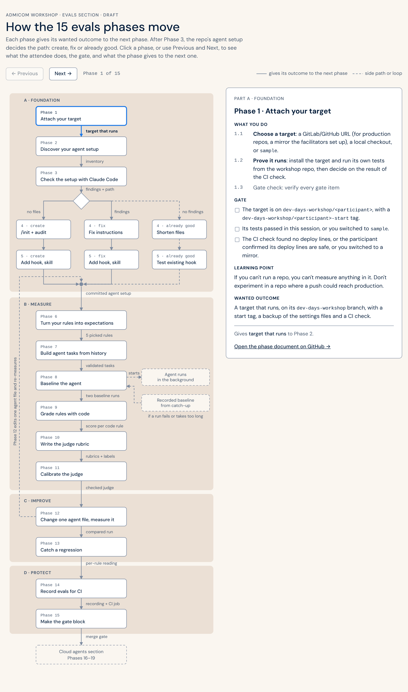

# Evals & Cloud Agents Workshop

A practical 1.5-day workshop on **checking how well coding agents follow your repo's rules**, and on **giving work to cloud agents safely**. You work on *your own* repository.

Tools: **Cursor** and/or **Claude Code** (use either, both, or switch at any time), with **GitLab or GitHub**. No API keys, and nothing secret in CI.

## How this works

There is no fixed tutorial to read. An AI coding assistant (Claude Code or Cursor) is your guide. It reads the plan in this repo, takes you through each phase, checks your work at each phase's Gate, and helps when something goes wrong.

This repo is the **workshop repo**. The repo you work on is the **target**:

1. Clone this repo and open it in your assistant.
2. Type `/workshop` (or paste `MASTER_PROMPT.md`).
3. The guide asks which repo you want to work in: a GitLab/GitHub URL, a local checkout, or the sample app in this repo.
4. It attaches the target under `targets/<name>/` on a new `dev-days-workshop/<you>` branch, detects its stack and commands, and every later phase works there.
5. Progress is saved in `.workshop/progress.json`, so you can stop and continue in a later session.

```
evals-cloud-agents-workshop/       ← open THIS in Cursor / Claude Code
├── AGENTS.md                      ← the guide's operating instructions
├── .agents/phases/                ← one document per phase
├── .agents/assets/                ← scripts the guide runs
├── kit/evals/                     ← eval runner (LLM judge, compare, calibrate, record and verify for CI)
├── kit/agent-evals/               ← runs a coding agent on tasks from your own git history and grades it per rule
├── kit/templates/                 ← CI jobs (GitLab + GitHub), agent suite folder, Cursor env, AGENTS.md snippets
├── kit/catchup/                   ← reference work for `pnpm workshop catchup`
├── docs/phase-flow/               ← interactive evals flow (GitHub Pages), built from the phase docs
├── docs/slides/                   ← workshop slides, speaker notes and the PDF (GitHub Pages)
├── samples/cost-coder/            ← sample target (TypeScript) with an agent setup that has problems on purpose
├── targets/                       ← gitignored — your attached repo(s) land here
└── .workshop/                     ← gitignored — progress, repo profile, notes, labels
```

## The evals flow

<a href="https://wunderdogsw.github.io/evals-cloud-agents-workshop/phase-flow/">
  <picture>
    <source media="(prefers-color-scheme: dark)" srcset="docs/phase-flow/flow-dark.png">
    
  </picture>
</a>

**[Open the interactive flow](https://wunderdogsw.github.io/evals-cloud-agents-workshop/phase-flow/)**: click a phase to see its steps, Gate, learning point and wanted outcome, with a link to the phase document. The page is built from the phase documents with `pnpm docs:flow`, and `pnpm test` fails if it is out of date. To view it without GitHub Pages, open `docs/phase-flow/index.html` in a browser.

**[Open the slides](https://wunderdogsw.github.io/evals-cloud-agents-workshop/slides/)** (press N for the speaker notes) · **[Download the slides as PDF](https://wunderdogsw.github.io/evals-cloud-agents-workshop/slides/evals-cloud-agents.pdf)**, with the speaker notes after each slide.

## What you do

| Section | Phase | What you do |
|---|---|---|
| Evals | [1 — Attach your target](.agents/phases/01-ATTACH-TARGET.md) | Attach a repo on a `dev-days-workshop` branch and prove its tests run |
| Evals | [2 — Discover your agent setup](.agents/phases/02-DISCOVER-AGENT-SETUP.md) | List what the agent really loads: instructions, rules, skills, hooks, MCP |
| Evals | [3 — Check the setup with Claude Code](.agents/phases/03-CHECK-SETUP.md) | `claude doctor`, `/doctor` and `/doctor prompt-audit`; rank the findings |
| Evals | [4 — Fix the instruction files](.agents/phases/04-FIX-INSTRUCTIONS.md) | Make sure the instructions load, don't contradict each other and stay short; audit again |
| Evals | [5 — Add skills, hooks and permissions](.agents/phases/05-SKILLS-HOOKS-PERMISSIONS.md) | A skill that runs the app, a hook that blocks a broken rule, a checked list of allowed commands |
| Evals | [6 — Turn your rules into expectations](.agents/phases/06-RULES-TO-EXPECTATIONS.md) | Mark each rule checkable by code or by a judge; pick five |
| Evals | [7 — Build agent tasks from your history](.agents/phases/07-AGENT-TASKS.md) | Turn merged changes into agent tasks, graded by the tests from the real change |
| Evals | [8 — Baseline the agent](.agents/phases/08-BASELINE-AGENT.md) | Run the tasks with and without your setup |
| Evals | [9 — Grade rules with code](.agents/phases/09-CODE-GRADERS.md) | Code that checks each code rule on the agent's diff |
| Evals | [10 — Write the judge rubric](.agents/phases/10-JUDGE-RUBRIC.md) | A rubric for each judge rule, and your own labels before any judge runs |
| Evals | [11 — Calibrate the judge](.agents/phases/11-CALIBRATE-JUDGE.md) | Check the judge against your labels; find out if it is too lenient or too strict |
| Evals | [12 — Change one agent file, measure it](.agents/phases/12-CHANGE-AND-MEASURE.md) | One change, a compared run, a keep-or-revert decision |
| Evals | [13 — Catch a regression](.agents/phases/13-CATCH-REGRESSION.md) | Read the scores per rule and explain a rule that got worse |
| Evals | [14 — Record evals for CI](.agents/phases/14-RECORD-FOR-CI.md) | Record a run with a hash of each tracked file; CI checks it without a model |
| Evals | [15 — Make the gate block](.agents/phases/15-MERGE-GATE.md) | One MR/PR passes the gate, one is blocked |
| Cloud agents | [16 — Delegate](.agents/phases/16-DELEGATE.md) | Give an issue to Claude Code or Cursor in headless mode; an MR/PR comes back |
| Cloud agents | [17 — Cloud agents](.agents/phases/17-CLOUD-AGENTS.md) | The same task handover, in a cloud VM |
| Cloud agents | [18 — Guardrails](.agents/phases/18-GUARDRAILS.md) | A review agent, and an agent section in AGENTS.md, measured |
| Cloud agents | [19 — Capstone](.agents/phases/19-CAPSTONE.md) | Several agents on a backlog; you decide what to merge from the evidence |

## Prerequisites

- Node.js 22+ and pnpm (`corepack enable`)
- Git
- Claude Code 2.1.283 or later (needed for `/doctor prompt-audit` in Phases 2–4), logged in. Cursor is optional.
- Agents and judges run on your own subscription, **no API key needed**. Scripted steps use the `claude` CLI or Cursor's `agent` CLI.
- From Phase 14: a GitLab project or GitHub repo you can push a `dev-days-workshop/*` branch to, with CI turned on (GitLab Premium/Ultimate if you want Cursor cloud agents on it)

## From zero to action

```bash
git clone <this repo> evals-cloud-agents-workshop
cd evals-cloud-agents-workshop
pnpm install
```

Open the folder in Cursor or Claude Code, then type **`/workshop`**.

The guide uses these helpers. You can also run them yourself:

```bash
pnpm workshop attach sample            # or a git URL, or a path to a local checkout
pnpm workshop install <target> agent-suite   # kit components: agent-tasks, agent-suite, ci-agent-evals, cursor-env, …
pnpm workshop delegate <target> --issue 3   # Claude Code or Cursor CLI works on the issue, opens an MR/PR
pnpm workshop catchup 6                # new sample target, ready to start Phase 6
pnpm agent-evals --help                # run, grade, label and record agent runs
pnpm evals --help                      # compare runs, calibrate a judge
```

## GitLab vs GitHub

Both are fully supported. The guide detects the host from your target's remote and picks the right templates:

| | GitLab | GitHub |
|---|---|---|
| Agent eval gate | `.gitlab-ci.yml` job checks the committed recording; JUnit results in the MR | Actions workflow checks it; check result on the PR |
| Delegated agent | `pnpm workshop delegate` (Claude Code or Cursor CLI) → MR | same → PR |
| Cloud agent | Cursor cloud agents (Premium/Ultimate) | Cursor cloud agents, Claude Code cloud sessions |
| Review agent | `pnpm workshop review` / Cursor Bugbot | `pnpm workshop review` / Cursor Bugbot |

Extra templates for organisations that *do* allow a model credential in CI (`ci-evals-live`, `ci-claude`, `ci-review`) are in `kit/templates/ci/`. The workshop doesn't use them.

## Dry runs (facilitators)

Each path of Phases 3–5 can be tried on the sample, with a different agent setup:

```bash
pnpm workshop attach sample --setup broken   # default: problems added on purpose → the "fix" path
pnpm workshop attach sample --setup good     # the reference fix → the "already good" path (targets/cost-coder-good)
pnpm workshop attach sample --setup none     # no CLAUDE.md or AGENTS.md → the "create" path (targets/cost-coder-none)
```

All three use the same tasks, so the results of Phases 8–15 can be compared between them. The last one you attach becomes the active target; change `activeTarget` in `.workshop/progress.json` to switch.

## Publishing the pages (facilitators)

The `docs/` folder is a small website: a start page, the evals flow, and the slides with a PDF download. GitHub Pages publishes it from `main`.

1. Merge your changes to `main` and push.
2. In GitHub, open **Settings → Pages**. Under *Build and deployment*, set *Source* to **Deploy from a branch**, the branch to **main** and the folder to **/docs**. Save.
3. After a minute or two the site is at https://wunderdogsw.github.io/evals-cloud-agents-workshop/.

The site is public even when the repo is private. Anyone with the link can see the slides, including the facilitator photos.

To update the pages:

- **Evals flow:** run `pnpm docs:flow` after you change a phase document. `pnpm test` fails if you forget. Add `--images` to also update the README pictures.
- **Slides:** `docs/slides/index.html` is a copy of the slide deck, and `docs/slides/notes.json` is a copy of its speaker notes (one entry per slide). After you update either one, run `pnpm docs:slides`. It puts the notes into the page and writes the PDF again. When you replace `index.html` with a new version of the deck, keep its local changes: the PDF link in the toolbar, the `static-notes` script tag and `useStaticNotes()`. `pnpm test` fails if the page doesn't have the notes from `notes.json`.
- Both scripts need Playwright for the PDF and the pictures (`pnpm add -D playwright` and `npx playwright install chromium`).

Then commit, merge to `main` and push. GitHub Pages updates on its own.

## Manual vs generated work

The guide writes the setup code. **You** write the things that decide the result:

- the inventory and findings about your agent setup,
- the rules you pick and how each is checked,
- the agent task prompts,
- the rule graders, the judge rubrics and your labels,
- the thresholds and the keep-or-revert decisions,
- the task prompts you give to cloud agents.

If the guide writes these for you, the measurement checks the guide's opinion, not yours.
